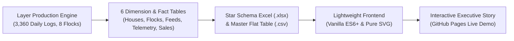

# Commercial Layer Operations: Flock Lifecycle, Hen-Day Dynamics & Egg Market Intelligence

[](https://wijaya-rama.github.io/portfolio-layer-poultry/)
[](LICENSE)
[](https://developer.mozilla.org/en-US/docs/Web/JavaScript)
[](data/)
[](https://www.linkedin.com/in/ramawijaya1)

> **Executive Commercial Layer Operations & Agribusiness Intelligence Dashboard** evaluating flock egg-laying trajectories, hen-day persistence, feed conversion efficiency (FCR), microclimate heat stress (THI), shell defect kinetics, and commercial break-even economics across **199,410 housed pullets**, **8 commercial flocks**, and **3 production hubs (Blitar, Kendal, Payakumbuh)** over a full 60-week laying cycle (Weeks 18–77 / 420 days).

[Launch Interactive Storyboard (Live Demo)](https://wijaya-rama.github.io/portfolio-layer-poultry/)

---

## Executive Summary

Commercial egg farming in tropical climates operates under severe physiological constraints governed by ambient heat stress, feed conversion efficiency, shell calcification integrity, and volatile wholesale egg price cycles. This project delivers an end-to-end quantitative investigation comparing modernized automated **Closed House Multi-Tier H-Frame** facilities against conventional **Open House Battery** operations in Indonesia's primary poultry hubs (Blitar Central Cluster, Kendal Modern Farm, and Payakumbuh Highland Unit).

Synthesizing 3,360 daily production and IoT microclimate log records across 8 full-scale commercial flocks (126,817 Closed House housed pullets vs. 72,593 Open House housed pullets), this analytics suite models the entire biological production curve from onset of lay (Week 18), peak production (Weeks 26–34), mid-lay persistence, through late-lay commercial depletion (Week 77). The project incorporates empirical performance standards from Lohmann Brown-Classic and Hy-Line Brown management guides, Kaggle poultry IoT telemetry data, and actual market pricing benchmarks from Pinsar Petelur Nasional (PPN).

---

## Key Commercial & Biological Insights

```text
+-----------------------------------------------------------------------------------------+
|                                    CORE TAKEAWAYS                                       |
+---------------------------+---------------------------+---------------------------------+
|   Persistence & HDP Gap   |    Feed Efficiency (FCR)  |    Shell Quality & Alkalosis    |
|   Closed: 30.2 weeks >90% |   Closed: 2.096 kg/kg     |    Closed: 1.35% reject rate    |
|   Open: 0.0 weeks >90%    |   Open: 2.420 kg/kg       |    Open: 6.61% reject rate      |
|   -96.2 eggs/bird HHP gap |   IDR 2,556/kg feed save  |    ~80% defect rate reduction   |
+---------------------------+---------------------------+---------------------------------+
```

### 1. Hen-Day Persistence Gap: Closed House Sustains 30-Week Peak vs Rapid Open House Drop
* **Closed House** flocks achieved an average **Peak Hen-Day Production (HDP) of 96.6%** and sustained production $\ge 90\%$ for **30.2 consecutive weeks**, yielding an average of **351.5 eggs per hen housed (HHP)** over the 60-week cycle.
* **Open House** flocks peaked at **90.1%** on a single peak day, but failed to sustain $\ge 90\%$ production on a weekly basis (**0.0 weeks persistence**), hovering at 82–84% and dropping rapidly after Week 38 to finish at **255.3 eggs per hen housed**.
* This net gap of **-96.2 eggs per housed bird (-27.4%)** combined with Open House mortality of **26.56%** vs. **5.92%** demonstrates that climate-controlled tunnel ventilation and automated 16-hour photoperiod schedules protect pituitary gonadotropin secretion (LH and FSH) from tropical heat disruptions.

### 2. Feed Conversion Disparity (0.324 kg/kg) Drives IDR 1.7 Billion Cycle Feed Savings
* Closed House operations achieved a cumulative lifetime FCR of **2.096 kg feed per kg egg mass**, closely matching international Lohmann genetic benchmarks (2.00–2.15).
* In contrast, Open House flocks recorded an FCR of **2.420 kg feed per kg egg mass**, consuming 0.324 kg more feed for every kilogram of eggs produced due to excessive maintenance energy wasted during thermal panting.
* At a weighted average feed cost of IDR 7,890/kg, Closed houses saved **IDR 2,556 per kg of eggs produced**. For a standard commercial unit of 30,000 layers producing ~675 tons of eggs per cycle, this efficiency preserves **IDR 1.72 Billion in cash**.

### 3. Shell Integrity & Respiratory Alkalosis: ~80% Defect Rate Reduction
* Egg shell defect and reject rates averaged only **1.35%** in Closed House units, supported by automated multi-tier conveyor belts and active evaporative cooling pads maintaining comfortable microclimates (mean Temperature-Humidity Index / THI of 71.5).
* Open House reject rates surged to **6.61%** (1.23 million reject eggs across 4 flocks). Ambient temperatures exceeding 31°C ($THI \ge 78.0$) induce hyperventilation panting, driving excessive blood $\text{CO}_2$ exhalation (*respiratory alkalosis*). The resulting collapse in blood bicarbonate ($\text{HCO}_3^-$) availability starves the uterine shell gland, causing thin, fragile, and micro-cracked shells.
* Automated conveyor transport eliminates manual collection impacts, recovering substantial margin bleed that would otherwise be sold at steep discounts to liquid egg or bakery processors.

### 4. Commercial Break-Even Economics: IDR 22,550/kg vs IDR 25,470/kg BEP
* Closed House units operated with an all-in operational Break-Even Point (BEP) of **IDR 22,550 per kg**, delivering **IDR 7.26 Billion in cumulative net profit** (+IDR 2,542 / kg net margin) across 4 units.
* Open House units incurred an elevated BEP of **IDR 25,470 per kg**, suffering a cumulative net loss of **-IDR 1.14 Billion** (-IDR 968 / kg margin) due to high feed conversion, heavy shell rejection, and elevated heat stroke mortality (26.6% vs 5.9%).
* Closed House operations remained commercially viable and cash-flow positive across almost the entire cycle, experiencing brief pressure only during extreme market troughs (Weeks 66–70).

---

## Strategic Agribusiness Recommendations

| Operational Pillar | Target Metric | Strategic Field Intervention |
| :--- | :--- | :--- |
| **1. Tunnel Microclimate Control** | Maintain THI < 74.0 | Modulate evaporative cooling pads and variable-speed tunnel exhaust fans to keep effective house temperature between 22°C and 25°C, preventing panting-induced alkalosis. |
| **2. Phase Feeding Nutrition** | FCR < 2.10 kg/kg | Implement 3-phase commercial feeding: Phase 1 (18.2% CP, 3.85% Ca) up to Week 45; Phase 2 (17.2% CP, 4.10% Ca); Phase 3 (16.2% CP, 4.35% Ca + coarse limestone grit) for late-lay shell calcification. |
| **3. Automated Conveyor Handling** | Reject Rate < 1.5% | Synchronize egg conveyor speed to under 0.15 m/s with soft rubber transition fingers at packing tables to eliminate mechanical micro-cracks. |
| **4. Active Manure Belt Drying** | Ammonia < 10 ppm | Operate continuous polypropylene manure belt dryers with active duct blowers; clear droppings every 48 hours to preserve tracheal cilia health and suppress respiratory pathogens. |
| **5. Photoperiod Lighting Schedule** | 16L : 8D Photoperiod | Maintain constant 16-hour light schedule at 20–30 lux using dimmable warm-spectrum LED lighting to stabilize pituitary gonadotropin hormonal release regardless of seasonal sunlight variations. |

---

## Data Architecture & Dimensional Model



### 1. Relational Star Schema Model (`data/`)
* **`layer_operations_star_schema.xlsx` (1.8 MB):** Comprehensive relational dimensional model containing 6 structured worksheets:
  * **Dimension Tables:**
    * `dim_house` (8 rows): Housing architecture, cage tier system, ventilation type, manure removal system, location cluster, capacity.
    * `dim_flock` (8 rows): Breed strain, pullet supplier, placement date, initial pullet placements, final liveability.
    * `dim_feed` (3 rows): Laying phases (P1, P2, P3), crude protein %, calcium %, phosphorus %, metabolizable energy, pricing.
    * `dim_date` (420 rows): Sequential calendar tracking, cycle week (W18–W77), year, month, quarter.
  * **Fact Tables:**
    * `fact_daily_production` (3,360 rows): Daily live hens, eggs collected, egg weight (g), reject count, feed consumption (kg), water intake (L).
    * `fact_daily_microclimate` (3,360 rows): Temperature (°C), relative humidity (%), calculated THI, ammonia level (ppm), air speed (m/s).
* **`layer_operations_flat.csv` (1.9 MB):** Unified analytics flat table with 58 production fields (daily HDP %, cumulative HHP, daily FCR, feed cost, egg revenue, gross margin, spent hen salvage, and environmental flags).

### 2. Frontend Engineering & Design System
* **Zero External Dependencies:** Built entirely with **Semantic HTML5**, CSS variables, and **Vanilla JavaScript (ES6+)** — zero heavy npm packages or external charting libraries.
* **Native Pure SVG Visualizations:** Custom interactive Hen-Day trajectory curves, egg weight maturation series, FCR dynamics, THI vs. reject correlation, and BEP margin sensitivity charts rendered directly into the DOM with zero lag.
* **100% Reactive Multi-Parameter Filtering:** Real-time client-side calculation across Housing Type, Cluster Region, and Breed Strain instantly updates all KPI cards, comparative tables, and SVG series in < 2ms.
* **Dual-Theme & Bilingual Localization:** Modern minimalist Bento Grid interface featuring instant theme toggle (Dark / Light) and bilingual language switching (**Bahasa Indonesia / English**) with floating LinkedIn author watermark.

---

## Repository Structure

```text
portfolio-layer-poultry/
├── index.html       # Standalone interactive executive storyboard (GitHub Pages entry point)
├── .gitignore       # Git exclusion rules for OS, temporary, and build files
├── LICENSE          # MIT Open-Source License
├── README.md        # Comprehensive project documentation & commercial analysis
├── assets/          # Project visualization assets and preview media
└── data/
    ├── layer_operations_flat.csv          # Master 58-column analytics flat table (3,360 rows)
    └── layer_operations_star_schema.xlsx  # Multi-sheet relational Star Schema model
```

---

## Author & Attribution

* **Curated & Developed by:** [Rama Wijaya](https://www.linkedin.com/in/ramawijaya1)
* **Domain Context:** Commercial Layer Poultry Production & Agribusiness Market Intelligence
* **Data Foundation:** Lohmann Brown-Classic / Hy-Line Brown Management Guides & Pinsar Petelur Nasional (PPN) Market Telemetry
* **License:** [MIT License](LICENSE)
